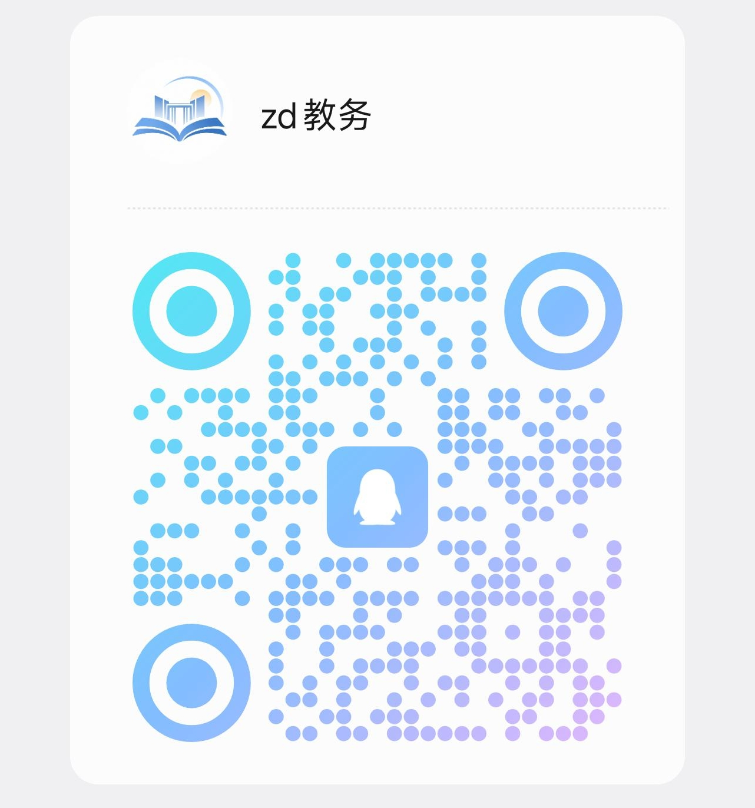

# 教务助手小程序

> 天津中德应用技术大学的非官方教务小程序，由同学自己写、自己维护，现在把源码全部开源出来。

查成绩、看课表、查考试、找空教室，教务系统晚上关机也能看缓存——这些本来就是每个同学都需要的东西，所以代码也应该是大家的。欢迎围观、提 Issue、提 PR，也欢迎拿去改成适配你们学校的版本。

## 加入交流群

使用中遇到问题、有想要的功能、想参与开发，或者只是想和同学聊聊，都欢迎加 QQ 群 **「zd教务」**：

<p align="center">
  
</p>

> 群里请不要发送自己的教务账号和密码。

## 功能

- **成绩查询**：按学期查看各科成绩
- **课程表**：按周查看，支持切换学期；可一键导出 [WakeUp 课程表](https://wakeup.fun/) 可导入的 CSV
- **考试安排**：按当前时间自动标记「已结束 / 进行中」
- **教室课表**：查看各教室的排课情况，找空教室上自习
- **教材查询**：查看课程教材及详情
- **课前提醒**：基于微信订阅消息，在上课前推送提醒（需部署云函数）
- **离线缓存**：打开过的课表、成绩、考试、教材都会缓存，教务系统夜间关机或断网时也能看
- **录取查询**：新生可查询录取结果
- **公告**：公告由云端下发，修改公告无需发版

## 目录结构

```
miniprogram/            小程序前端（页面、工具函数、TDesign 精简组件包）
  pages/                主包页面：登录、首页、课表、成绩、考试、教室、教材……
  subpackages/          分包：通知中心、公告、学习通任务
  utils/                数据整理、缓存、学期计算、WakeUp 导出等
cloudfunctions/         微信云开发云函数
  scheduleReminderFunctions/   课前提醒（订阅记账、定时推送）
  noticeFunctions/             云端公告
  studyTaskFunctions/          学习通任务下发
  xpayFunctions/               虚拟支付
chaoxing/               学习通任务引擎（基于 Samueli924/chaoxing，GPL-3.0）
scripts/                构建、WakeUp 导出等脚本
tests/                  Node 内置测试
```

## 本地运行

> 仓库仅作源码展示：真实的接口地址、云开发环境、支付配置和部署文档都没有提交（见 `.gitignore`）。想跑起来需要自己补上这些配置文件。

1. 安装依赖并生成精简组件包：

   ```bash
   cd miniprogram
   npm ci
   npm run build:ui
   ```

2. 补齐被忽略的配置文件，主要是 `miniprogram/utils/api.js`（教务接口封装）以及 `notification-config.js`、`payment-config.js`、`task-config.js` 等云开发配置。配置留空时相关功能会显示「未部署」提示，不影响查询类功能的代码阅读。

3. 用微信开发者工具打开仓库根目录，填写自己的 AppID 后编译。

4. 运行测试：

   ```bash
   node --test tests/*.test.js
   ```

   部分测试依赖上面那些未提交的配置文件，缺少时会报 `Cannot find module`，补齐配置后即可通过。

### 开发说明

- **UI 组件**：使用 [TDesign Miniprogram](https://tdesign.tencent.com/miniprogram/)，`miniprogram_npm` 只保留实际用到的组件。新增组件时先在页面或 `app.json` 注册，再执行 `npm run build:ui`；若用了开发者工具的「构建 npm」，记得再跑一次 `npm run build:ui` 恢复精简包。`npm run check:ui` 检查生成文件是否一致。
- **离线缓存**：新增读取教务接口的页面请统一走 `loadWithCache`（先显示缓存、后台刷新、失败保留缓存），教务系统夜间会关机。
- **WakeUp 导出**：小程序内在课表页「更多 → 导出 WakeUp CSV」；电脑端可在 PowerShell 运行 `./scripts/export-wakeup.ps1`，输出到 `outputs/wakeup/`（已忽略，不要提交个人课表）。格式依据见 [WakeUp 文档](https://wakeup.fun/doc/import_from_csv.html)。
- **更新日志**：见 [CHANGELOG.md](CHANGELOG.md)。

## 参与贡献

- 发现 Bug 或有功能建议：提 Issue，或者直接在 QQ 群里说
- 想改代码：Fork 后提 PR，改动尽量附上对应测试
- 想适配自己学校：主要改 `utils/api.js` 的接口封装和各 `*-data.js` 的数据整理逻辑

## 声明

- 本项目为学生个人开发，**与学校及教务处无关**，不是官方应用。
- 请勿在任何第三方渠道（包括交流群）泄露自己的账号密码。
- 请合理使用，不要用于高频抓取或其他给教务系统造成负担的用途。